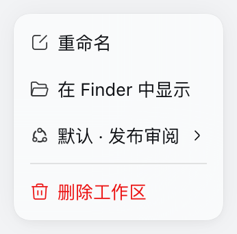
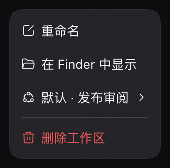
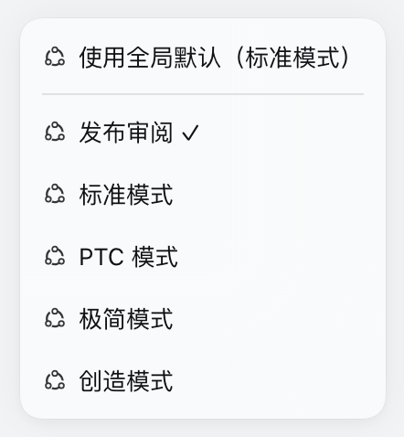
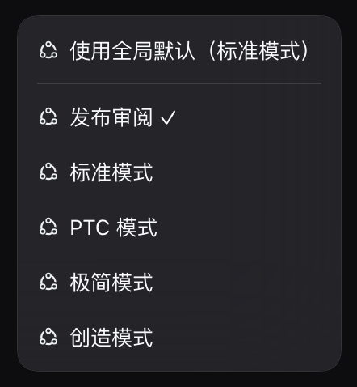

# @miorin/dsh-workspace-default-preset

[简体中文](README.zh.md)

Set a default Agent preset per Workspace: right-click a Workspace in the sidebar, choose **Default**,
and pick a preset or **Use global default**.

- Saves `<workspace>/.dsh/agent-preset.json`;
  precedence is explicit Session preset > Workspace default > global default (applies to Web Client sessions;
  schedules and subagents keep their own presets).
- The file is cached per Workspace (reopen the menu or reload DSH after editing manually);
  missing preset IDs fall back to the global default with one warning.
- Requires DeepSeek Harness `0.2.2-rc.3` or newer.
  Included in **Workspace Modular Improvement Plan** (`@miorin/dsh-atlas-workspace`); install either one, never both.
- Standalone install: run `pnpm install --frozen-lockfile` in this directory and select it
  in **Plugins → Add plugin** (or via `plugin_manager`).

## Screenshots

The screenshots show the Chinese interface.

| | Light | Dark |
| --- | --- | --- |
| Default menu entry |  |  |
| Preset picker |  |  |

[Project documentation](docs/README.md)
