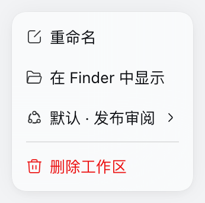
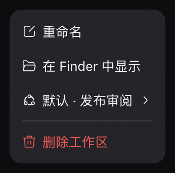
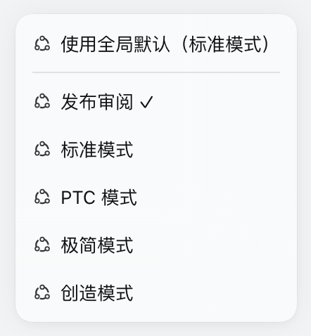
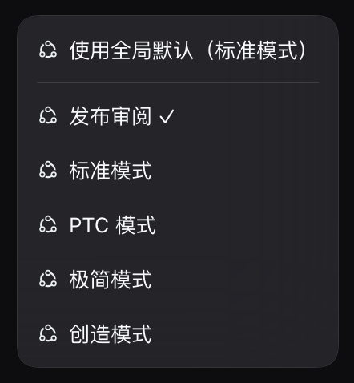

# @miorin/dsh-workspace-default-preset

[English](README.md)

为每个工作区设置默认 Agent preset：在侧栏右键工作区，打开 **默认**，选择 preset 或 **使用全局默认**。

- 配置保存在 `<工作区>/.dsh/agent-preset.json`，
  生效优先级为「会话显式 preset > 工作区默认 > 全局默认」（仅作用于 Web Client 新建会话，
  定时任务与子代理保持各自 preset）。
- 配置按工作区缓存，手工修改文件后需重开菜单或重载 DSH；失效的 preset ID 会忽略并记录一次警告后回退全局默认。
- 需要 DeepSeek Harness `0.2.2-rc.3` 或更新版本。
  本插件已包含于 **工作区模块化改良计划**（`@miorin/dsh-atlas-workspace`），两者请勿同时安装。
- 单独安装：在本目录运行 `pnpm install --frozen-lockfile` 后，
  从 **插件 → 添加插件** 选择本目录（或通过 `plugin_manager` 安装）。

## 实拍截图

| | 浅色 | 深色 |
| --- | --- | --- |
| 默认入口 |  |  |
| 默认预设列表 |  |  |

[项目文档](docs/README.md)
